# 🎲 Juegos de Salón

Mobile-first web app with party games to play with friends: card and dice games, word and logic puzzles, guessing games. Open it on a phone, pick a game, type in the players, and the phone runs the game. In Spanish, English, Portuguese and German, with no account needed.

**Play:** https://juegosdesalon.cl/

<!-- generated: screenshots:portada · written by python3 tools/release/readme.py update -->
<p align="center">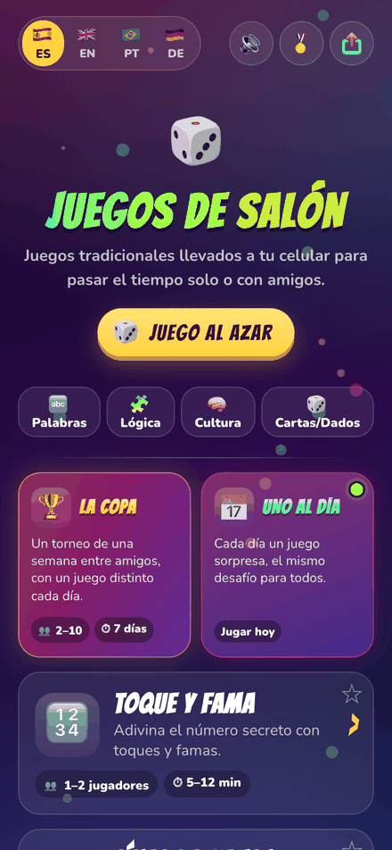&nbsp;&nbsp;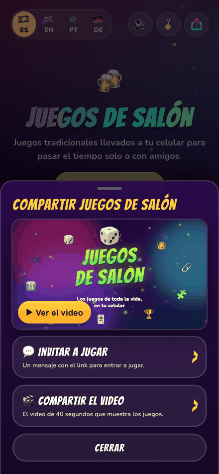</p>
<!-- /generated -->

**The two things to know first:**

- 🏆 **[The Cup](#-the-cup-la-copa)**: a week-long tournament for a group of friends, one daily game each day, the same for everyone.
- 📅 **[One a Day](#one-a-day)**: a surprise game every day, the same challenge for everyone, with streaks and a monthly points season.

Everything else is a game you play in a group (one phone passed around, or a room with each player on their own phone) or alone.

> Spanish is the default and the language the games are written in first; the other three are adaptations, not literal translations, and content only Chileans or Brazilians would know is tagged so a global Cup can leave it out (D-186, D-324). Everything internal to the repository is in English (D-316); some linked documents are still in Spanish while they are migrated. The screenshots show the app in Spanish.

## Games

The games with their own section below come first; after them, the one-player games that also make up The Cup, each opening on its own page.

<!-- generated: games · written by python3 tools/release/readme.py update -->
| Game | Players | Modes | Status |
|---|---|---|---|
| 🏆 [The Cup / La Copa / A Copa](#-the-cup-la-copa) | 2 to 10 | Each on their own phone | v0.83 |
| ⏳ [Timeline / Línea de Tiempo / Linha do Tempo](#-timeline-línea-de-tiempo) | 1 to 6 | One phone · Several phones · Play alone | v0.9 |
| 🔢 [Bulls and Cows / Toque y Fama / Toque e Fama](#-bulls-and-cows-toque-y-fama) | 1 to 2 | One phone · Two phones · Play alone | v0.4 |
| 🪢 [Hangman / El Ahorcado / Forca](#-hangman-el-ahorcado) | 1 to 6 | One phone · Several phones · Play alone | v0.26 |
| 🎲 [Liar's Dice / Dudo / Dado Mentiroso](#-liars-dice-dudo) | 1 to 6 | One phone · Several phones · Versus the phone | v0.32 |
| 📝 [Generala / General](#-generala) | 1 to 6 | One phone · Several phones · Play solo | v0.189 |
| ⚓ [Battleship / Batalla Naval / Batalha Naval](#-battleship-batalla-naval) | 1 to 2 | One phone · Two phones · Versus the phone | v0.6 |
| 🍹 [Julep / Julepe / Paga o Bolo](#-julep-julepe) | 1 to 6 | One phone · Several phones · Versus the phone | 🧪 lab |
| 👑 [Fourth King / Cuarto Rey / Quarto Rei](#-fourth-king-cuarto-rey) | 4 to 6 | One phone | 🧪 lab |
| 🔗 [Connections / Conexiones / Conexões](https://juegosdesalon.cl/connections/) | 1 | Play alone | 📦 La Bodega |
| 🔤 [Bulls and Cows: Word / Toque y Fama: Palabra / Toque e Fama: Palavra](https://juegosdesalon.cl/word/) | 1 | Play alone | Also in The Cup |
| 📅 [What Year? / ¿En qué año? / Em que ano?](https://juegosdesalon.cl/year/) | 1 | Play alone | Also in The Cup |
| 👑 [Queens / Reinas / Rainhas](https://juegosdesalon.cl/queens/) | 1 | Play alone | Also in The Cup |
| ☀️ [Tango](https://juegosdesalon.cl/tango/) | 1 | Play alone | Also in The Cup |
| 〰️ [Zip](https://juegosdesalon.cl/zip/) | 1 | Play alone | Also in The Cup |
| 🧶 [Untangle / Desenredo / Desenrola](https://juegosdesalon.cl/untangle/) | 1 | Play alone | Also in The Cup |
| 📍 [Where Is It? / ¿Dónde queda? / Onde fica?](https://juegosdesalon.cl/where/) | 1 | Play alone | Also in The Cup |
| 🔍 The Case / El caso / O Caso | 1 | Play alone | 🧪 lab |
| 🚇 [Broken Routes / Rutas rotas / Rotas Quebradas](https://juegosdesalon.cl/routes/) | 1 | Play alone | Also in The Cup |
| 📐 [Plots / Loteo / Loteamento](https://juegosdesalon.cl/plots/) | 1 | Play alone | Also in The Cup |
| 🖌️ [Paint Mines / Pintaminas / Pinta-Minas](https://juegosdesalon.cl/paint-mines/) | 1 | Play alone | Also in The Cup |
| 🕵️ [Agents / Agentes](https://juegosdesalon.cl/agents/) | 1 | Play alone | Also in The Cup |
<!-- /generated -->

---

## 🏆 The Cup (La Copa)

<!-- generated: screenshots:copa · written by python3 tools/release/readme.py update -->
<table>
  <tr>
    <td align="center">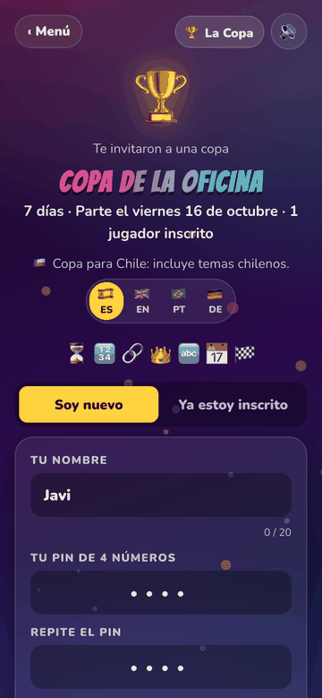<br><sub>The invite: your name and a 4-digit PIN</sub></td>
    <td align="center">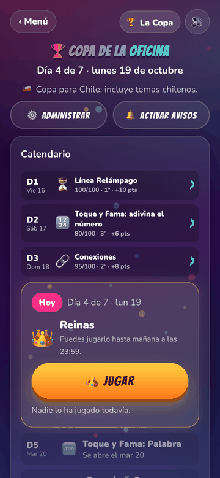<br><sub>Your days: past ones done, today open</sub></td>
    <td align="center">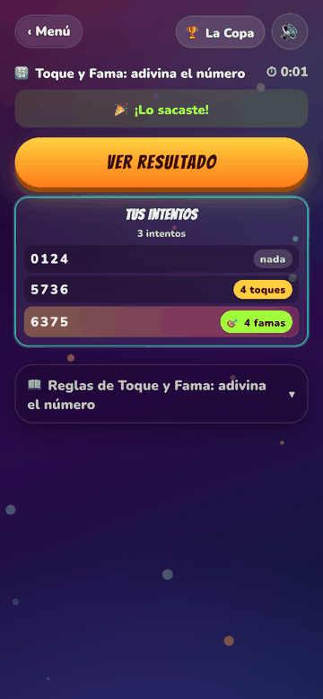<br><sub>Day 2: Bulls and Cows, guess the number</sub></td>
    <td align="center">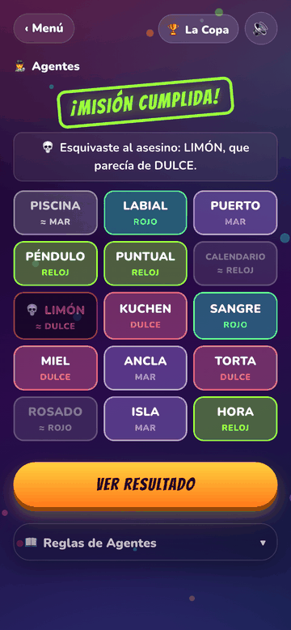<br><sub>Day 3: Agents, find your spies from the clues</sub></td>
  </tr>
  <tr>
    <td align="center">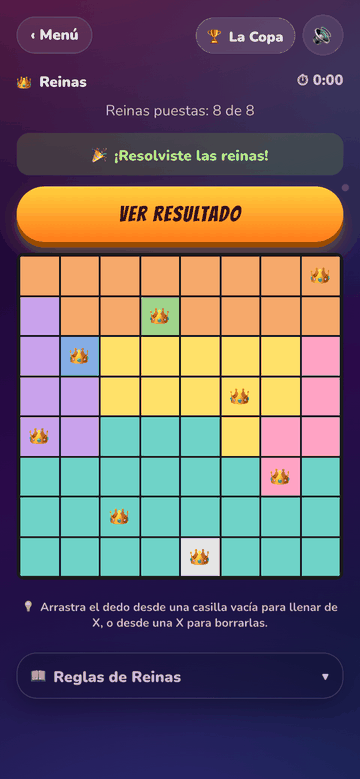<br><sub>Day 4: Queens</sub></td>
    <td align="center">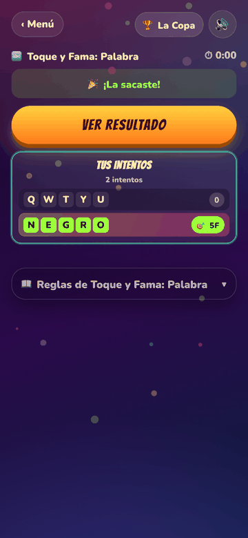<br><sub>Day 5: Bulls and Cows: Word</sub></td>
    <td align="center">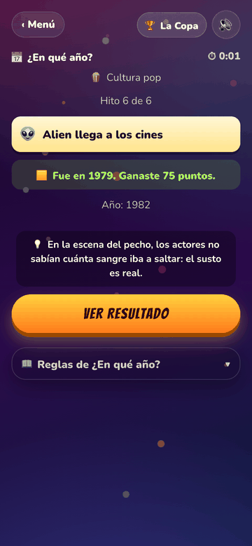<br><sub>Day 6: What year was it?</sub></td>
    <td align="center">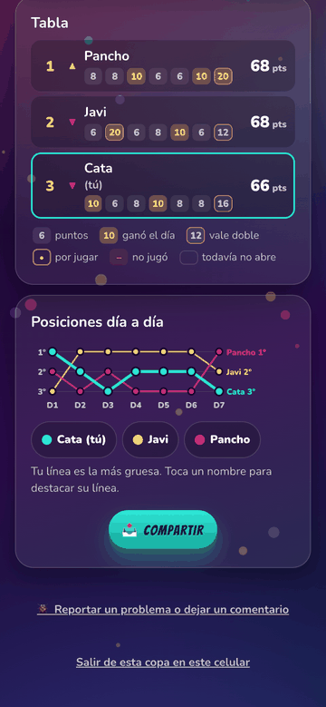<br><sub>Everyone's place, day by day</sub></td>
  </tr>
  <tr>
    <td align="center">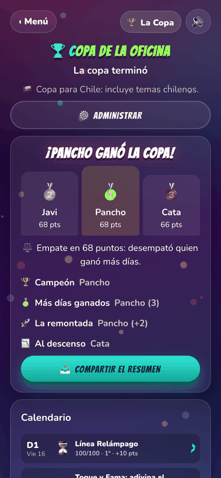<br><sub>Podium and medals</sub></td>
    <td align="center">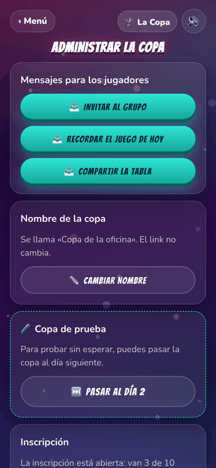<br><sub>The admin shares messages with the group</sub></td>
    <td align="center">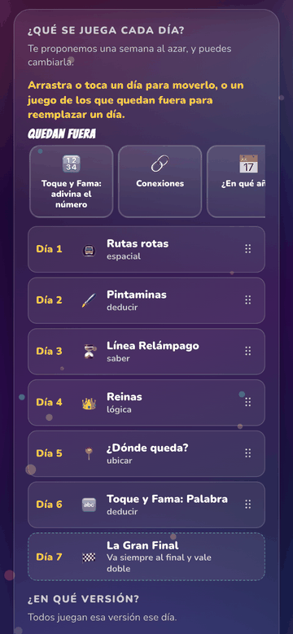<br><sub>Creating a cup: drag the games into the week</sub></td>
    <td></td>
  </tr>
</table>
<!-- /generated -->

Not a game but a **tournament that lasts a week**. Someone creates a cup and shares the link; everyone joins with their name and a 4-digit PIN, from any phone or computer. Every day a different game opens, **the same for everybody**, playable **once**. Each day hands out points by position (10, 8, 6, 5, 4, 3, 2, 1), so every day weighs the same and one crushing day does not decide the cup (D-94, D-113). The final is worth double, everyone gets one ×2 wildcard, and the most points on day 7 lifts the cup. It borrows what makes daily puzzles work (Wordle, Connections): same challenge, once a day, comparable scores, little luck, and a **share card** that does not give the answer away.

**The admin picks the week** (D-163) from thirteen games, dragging them into place, or takes a random proposal with no two days of the same skill in a row. The Grand Final always closes the cup. The classic week:

| Day | Game | Skill |
|---|---|---|
| 1 | ⏳ Timeline Flash: 10 milestones, placed with Timeline's drag and drop | knowledge |
| 2 | 🔢 Bulls and Cows: guess the number | deduction |
| 3 | 🕵️ Agents: find your 11 agents among 15 words from four clues (D-421) | association |
| 4 | 👑 Queens: one per row, column and color region, never touching; scored by solve time (D-166 to D-169, D-283) | logic |
| 5 | 🔤 Bulls and Cows: Word: a 5-letter word colored like Wordle; every letter pinned down scores | deduction |
| 6 | 📅 What year was it?: closer is better, older gets more slack | estimation |
| 7 | 🏁 The Grand Final: one round of each game of the week, worth double | everything |

The other seven: **〰️ Zip**, **☀️ Tango**, **📍 Where is it?** (drop a pin for five cities on an unlabeled satellite globe; up to 100 points each, minus 4 per 100 km off, D-155, D-159), **🧶 Untangle** (Simon Tatham's puzzle: ten levels of knots against a four-minute clock, D-179), and the three below. Every cup game also plays on its own from the menu at `/<slug>/` (D-142, D-149, D-198), with its own social card (D-162). The Cup reuses the app's existing UX rather than inventing its own (D-102).

How it works:

- **Everything comes from a seed** (`code:day`), so everyone plays the same content with no server (D-97).
- **A day stays open until the next midnight** (grace day), except the final. **Late sign-ups** stay open until the final unless closed or full (ten players); missed days score 0 (D-177). Time only breaks ties, and it is *active* time (D-95). **Two days in a row without playing leave a player out**, with a warning the day before; the admin can bring them back (D-347, D-376).
- **Results stay hidden until you play**, so the table cannot spoil today.
- **Accounts are a name and a PIN inside one cup**, on Firebase anonymous auth; the PIN hash is unreadable and the rules check it (D-96). Signed in to the leaderboards, **Your cups** follows you to any phone (D-220); finished cups hide behind **Show finished cups** (D-234, D-336).
- **The admin plays too**: renames, removes or re-PINs players, shares the invite, **today's reminder** with who is missing, the table and the final summary (D-99, D-171, D-176, D-165); can **end the cup early** (D-161) and **export the final table** as an image or CSV. A new cup opens with a short guide (D-110).
- **Every day has a practice round** that does not count (D-103), then a **3-to-1 countdown** before the clock starts (D-105, D-258); the result **explains its score** line by line (D-106).
- **A cup can have its own link** (D-121): `juegosdesalon.cl/cup/?pirata` instead of a 5-letter code.
- **Language** (D-170): the screen follows each player's language; the cup's language, chosen at creation, sets the words of the word games and every shared message. **Audience** (D-186, D-187): 🌎 Global, 🇨🇱 Chile or 🇧🇷 Brazil decides which local content is in.
- **Phone notifications** (D-223, D-224, D-228): a 🔔 bell per cup; reminders when a day opens or is running out, the final and the winner ([docs/PWA-NOTIFICACIONES.md](docs/PWA-NOTIFICACIONES.md)). A **recap window** on the home page shows how a cup you played ended, with the final table image the cup shares (D-423, D-426, D-427; `/?recap=demo`).
- **Bug reports and comments need no account** (D-104, D-341): the 🐞 form and the "💬 Suggestions and comments" link at the end of every game post to `feedback/`; an optional email gets a reply when resolved (D-317). Emails to **hola@juegosdesalon.cl** land there too (D-318).
- **🎉 The weekend cup** (D-439): until the end of Sunday, October 25, 2026 (Pacific time), a cup created on a Spanish screen can also last **3 days with 3 games each day**: 🎲 draws nine different games, each day plays its three one after the other, and the day's score is their average, which hands out the usual points by place. No final; cups already created play on after the option is gone.
- **Testing:** `?three` makes a 3-day cup (D-100); `?test` plays with no Firebase, as the demos, the screenshots and the end-to-end scripts do.

Spec and design: [docs/games/cup.md](docs/games/cup.md)

### 🚇 Broken Routes, 📐 Plots and 🖌️ Paint Mines

<!-- generated: screenshots:cup-new-games · written by python3 tools/release/readme.py update -->
<table>
  <tr>
    <td align="center">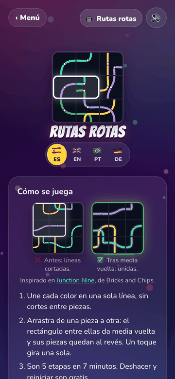<br><sub>Broken Routes: the waiting room</sub></td>
    <td align="center">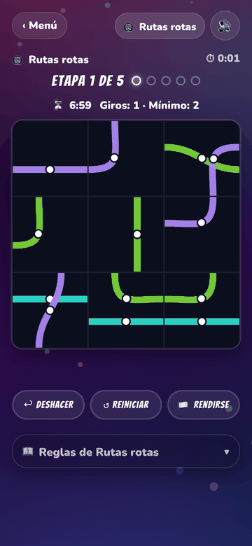<br><sub>Broken Routes: turn rectangles until every line joins</sub></td>
    <td align="center">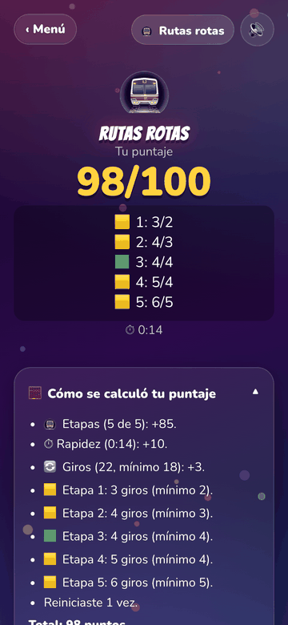<br><sub>Broken Routes: five stages, turns against the minimum</sub></td>
    <td align="center">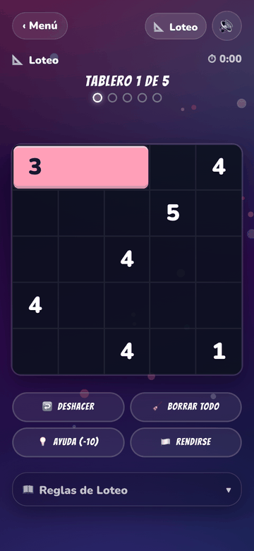<br><sub>Plots in Numbers: each number, a plot that size</sub></td>
  </tr>
  <tr>
    <td align="center">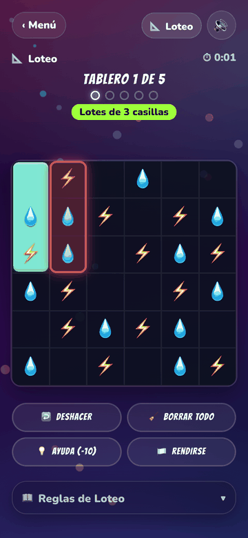<br><sub>Plots in Utilities: one ⚡ and one 💧 per plot</sub></td>
    <td align="center">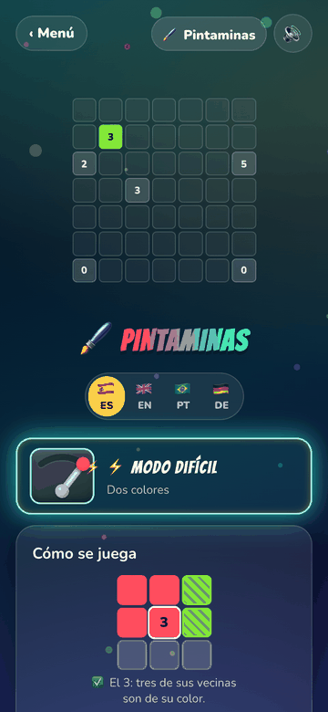<br><sub>Paint Mines: the lever picks hard, two colors</sub></td>
    <td align="center">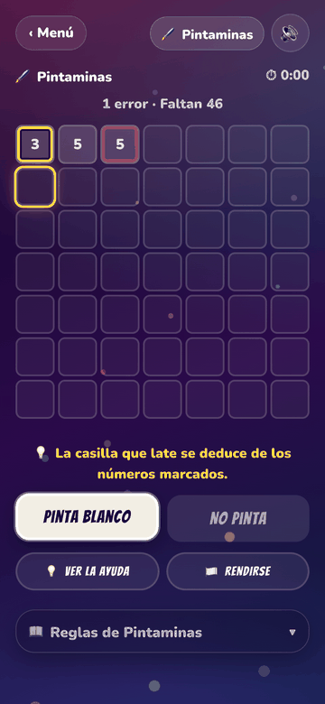<br><sub>Paint Mines: a 💡 hint marks a cell to deduce</sub></td>
    <td align="center">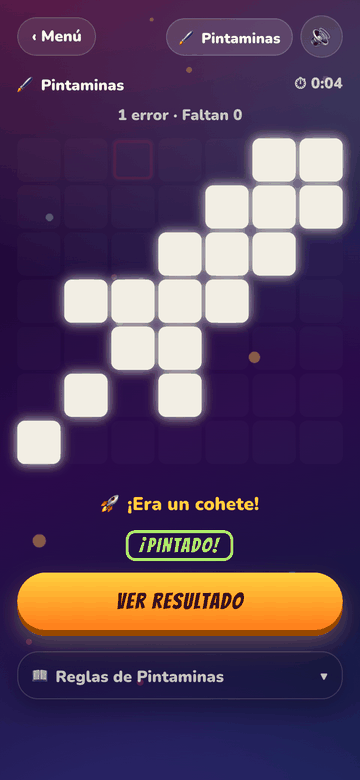<br><sub>Painted whole, the drawing shows</sub></td>
  </tr>
</table>
<!-- /generated -->

Three one-player games that left the lab together (D-332): on the home page, in The Cup's pool and replayed in the Grand Final (D-418). Standalone, every board is new; in a cup, the code and the day decide it.

- **🚇 Broken Routes** (`/routes/`; inspired by *Junction Nine*, by Bricks and Chips): turn rectangles of a 3×3 metro map until every color is one unbroken line; five stages against a 7-minute clock (D-293 to D-295).
- **📐 Plots** (`/plots/`; inspired by Nikoli's *Shikaku*): split the grid into rectangles, each holding one number equal to its area; five boards against the clock (D-310, D-312).
- **🖌️ Paint Mines** (`/paint-mines/`; inspired by *ColorSweeper*, by ARRKKA): a color Minesweeper whose solved grid is a drawing (D-289 to D-298).

**Variants** (D-331): Plots has 🔢 **Numbers** and ⚡💧 **Utilities**, Paint Mines **easy** and ⚡ **hard**. Standalone the player picks one (or the link says `?mode=…`), each with its own leaderboard; in a cup the admin picks it per day. Every variant scores 0 to 100.

Spec and design: [docs/games/routes.md](docs/games/routes.md), [docs/games/plots.md](docs/games/plots.md), [docs/games/paint-mines.md](docs/games/paint-mines.md)

### 🕵️ Agents

A one-player mini *Codenames* (inspired by [Codenames](https://czechgames.com/en/codenames/), by Vlaada Chvátil), at `/agents/`, in The Cup and in One a Day from 2026-10-24, in Connections' place (D-286, D-287, D-421). Four clues come one at a time, «SEA · 3», and you tap the 11 agents among 15 words while avoiding 3 neutrals (−15) and the assassin (−40). Hold a card to mark it suspect or ruled out. Each language has its own deck of about 118 clues, adapted, not translated.

Spec and design: [docs/games/agents.md](docs/games/agents.md)

### Retired cup games

**🔗 Connections** (16 words, 4 groups) was day 3 until Agents replaced it (D-421); old cups keep it and it still opens at `/connections/`, in the lab's Storeroom. **🔍 The Case**, a *Clues by Sam*-style deduction mystery, also sits in the Storeroom at `/labs/case/`, playable but no longer worked on (D-257, D-263, D-267, D-280).

---

## ⏳ Timeline (Línea de Tiempo)

Place undated events in the right spot on a shared timeline: right and the card stays, wrong and it is discarded. The first to place the cards needed wins; the round is always played to the end, and ties go to the fastest. Cards do not repeat across back-to-back games, and a new theme is just a data file.

<!-- generated: themes · written by python3 tools/release/readme.py update -->
| Theme | Cards | Years | What it covers |
|---|---|---|---|
| 📜 History | 96 | 2560 BC to 2022 | Milestones of humankind |
| 🎵 Music | 91 | 1600 to 2023 | From Beethoven to Taylor Swift |
| 🇨🇱 Chile | 120 | 1520 to 2023 | From the 1960 quake to the uprising |
| 🍿 Pop culture | 108 | 1928 to 2023 | Movies, memes and video games |
| 🇧🇷 Brazil | 139 | 1500 to 2025 | From Cabral to COP30, telenovelas and carnival included |
| ⚽ Soccer | 121 | 1863 to 2025 | World Cups, clubs, goals and transfers |
| **Total** | **675** | | |
<!-- /generated -->

- **📱 One phone** (two to six players) · **📡 Several phones** (a room with a code and QR, up to six, each with their own hand, and a chat) · **🧍 Play alone**: Timeline Flash, ten events scored 0 to 100 with a clock and a record per theme.
- **🗂 All cards on the table** (default): twice the cards needed are dealt face up and none is added, so the hard ones pile up for the end. **🃏 Shared pool**: six cards refilled from the deck, or **🙋 your own hand**.
- **💡 Every card tells you something** (D-277, D-314): the verdict gives a fact or anecdote, right or wrong; against the clock it pauses while you read.
- **Drag a card into place**, drawn large above your finger; dropping only chooses, and the yellow button places it.

<!-- generated: screenshots:linea-de-tiempo · written by python3 tools/release/readme.py update -->
<table>
  <tr>
    <td align="center">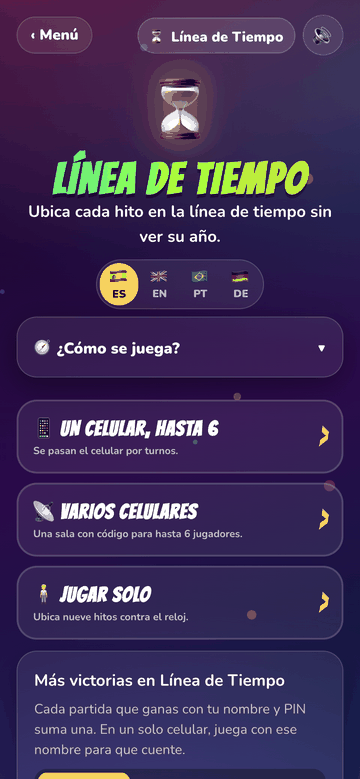<br><sub>Game modes</sub></td>
    <td align="center">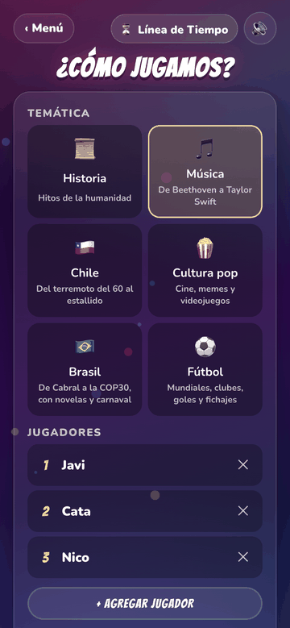<br><sub>Theme and players</sub></td>
    <td align="center">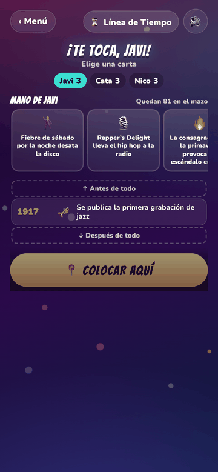<br><sub>Hand and timeline</sub></td>
    <td align="center">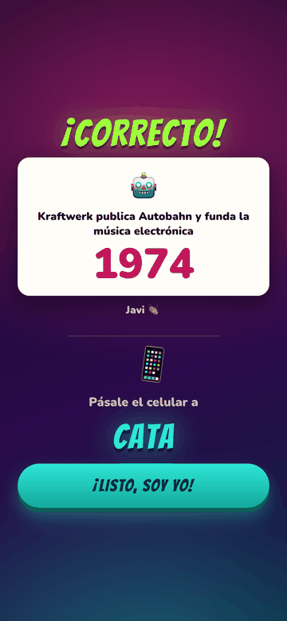<br><sub>Verdict and handoff</sub></td>
  </tr>
  <tr>
    <td align="center">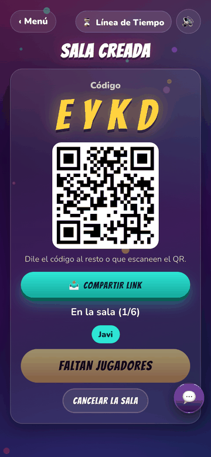<br><sub>Room with code and QR</sub></td>
    <td align="center">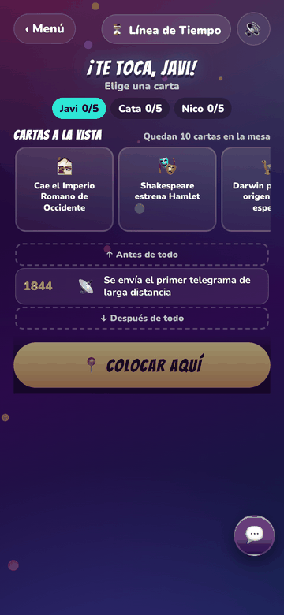<br><sub>Game on several phones</sub></td>
    <td align="center">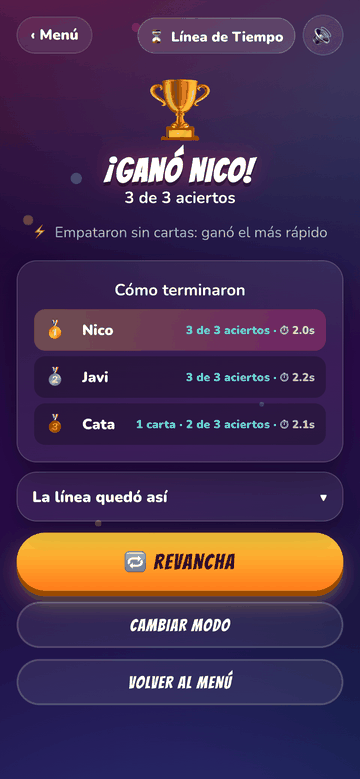<br><sub>Result and ranking</sub></td>
    <td align="center">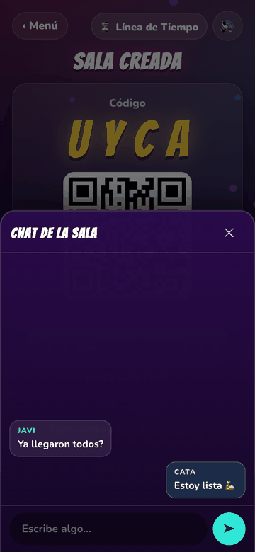<br><sub>Room chat</sub></td>
  </tr>
  <tr>
    <td align="center">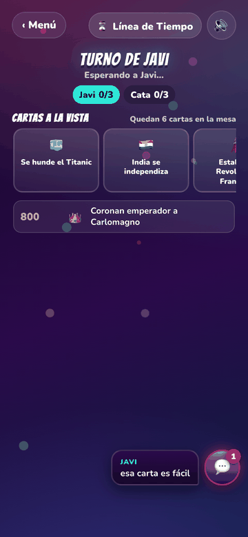<br><sub>New message label</sub></td>
    <td align="center">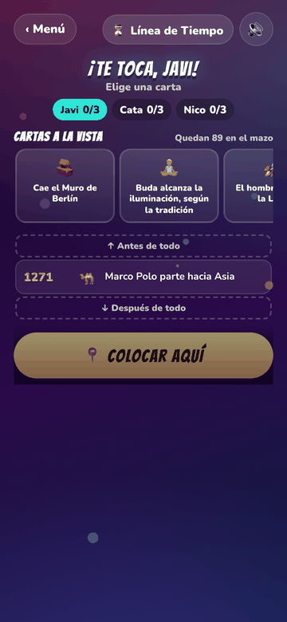<br><sub>Shared pool</sub></td>
    <td align="center">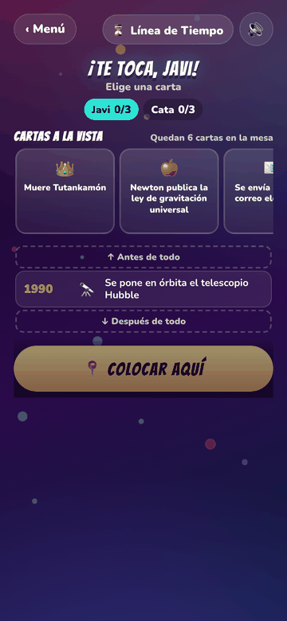<br><sub>All cards on the table</sub></td>
    <td></td>
  </tr>
</table>
<!-- /generated -->

Spec and design: [docs/games/timeline.md](docs/games/timeline.md)

## 🔢 Bulls and Cows (Toque y Fama)

Crack a secret number with no repeated digits. For every guess the phone answers on its own: **fama** is a right digit in the right place, **toque** a right digit elsewhere. Nobody counts by hand, nobody cheats.

- **📱 One phone:** pass it around, the screen covered between turns.
- **📡 Two phones:** a room with a code, a QR and a chat. Each phone keeps its own secret, both guess at once, fewer guesses wins, and everything is verified at the end.
- **🧍 Play alone:** The Cup's number game: 4 digits, 10 guesses, 100 points minus 10 per extra guess, with a clock and a record.

<!-- generated: screenshots:toque-y-fama · written by python3 tools/release/readme.py update -->
<table>
  <tr>
    <td align="center">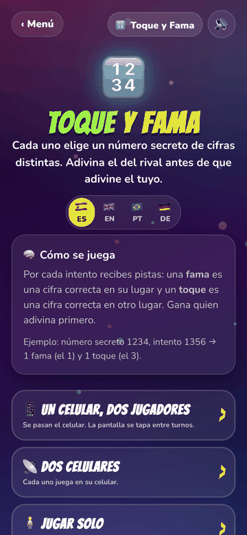<br><sub>Game modes</sub></td>
    <td align="center">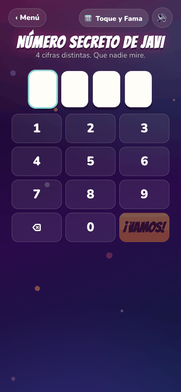<br><sub>Secret number</sub></td>
    <td align="center">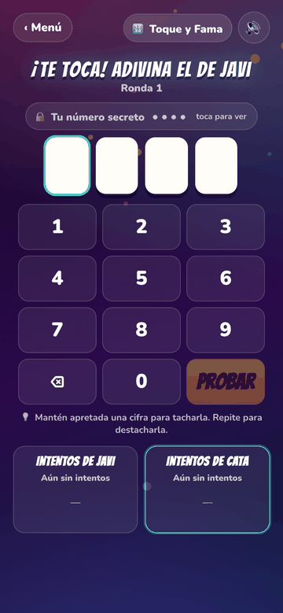<br><sub>Board and keypad</sub></td>
    <td align="center">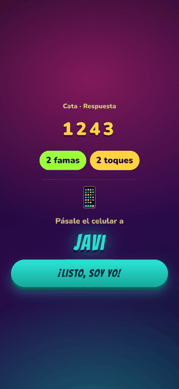<br><sub>Answer and handoff on one screen</sub></td>
  </tr>
  <tr>
    <td align="center">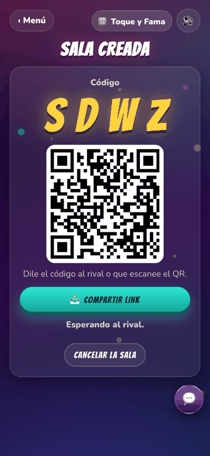<br><sub>Room with code and QR</sub></td>
    <td align="center">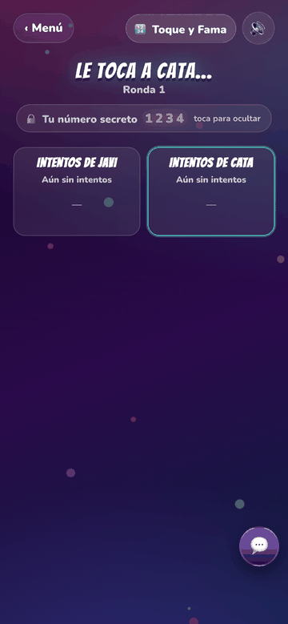<br><sub>Game on two phones</sub></td>
    <td align="center">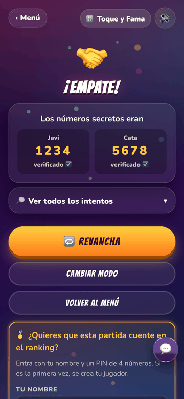<br><sub>Verified secrets</sub></td>
    <td align="center">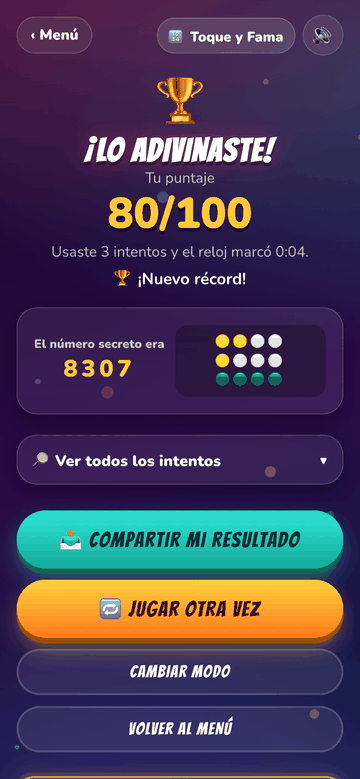<br><sub>Playing alone: a new record</sub></td>
  </tr>
  <tr>
    <td align="center">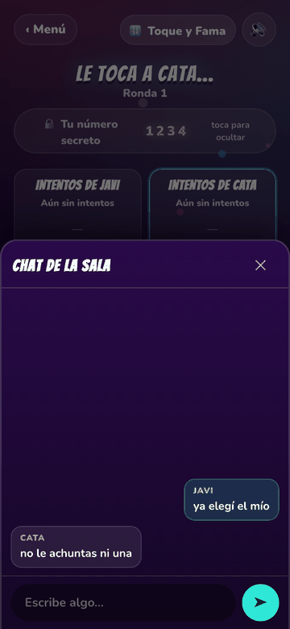<br><sub>Room chat</sub></td>
    <td></td>
    <td></td>
    <td></td>
  </tr>
</table>
<!-- /generated -->

Spec: [docs/games/bulls-and-cows.md](docs/games/bulls-and-cows.md) · Feasibility study: [docs/games/bulls-and-cows-factibilidad.md](docs/games/bulls-and-cows-factibilidad.md)

## 🪢 Hangman (El Ahorcado)

<!-- generated: screenshots:ahorcado · written by python3 tools/release/readme.py update -->
<table>
  <tr>
    <td align="center">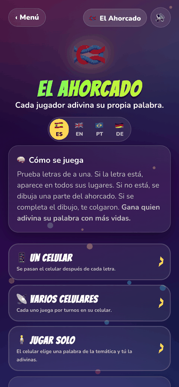<br><sub>Game modes</sub></td>
    <td align="center">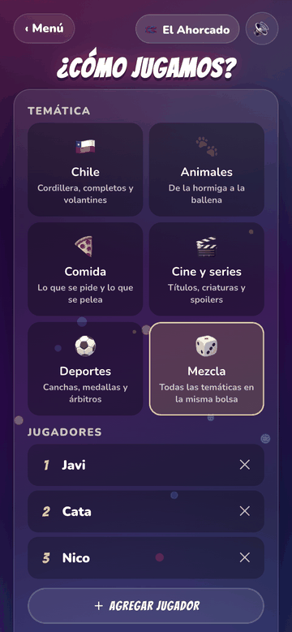<br><sub>Theme and who plays</sub></td>
    <td align="center">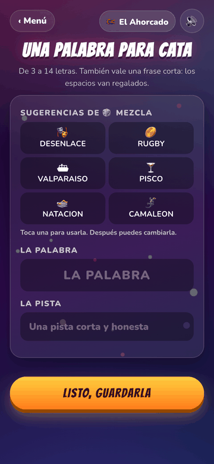<br><sub>Each player writes for the next</sub></td>
    <td align="center">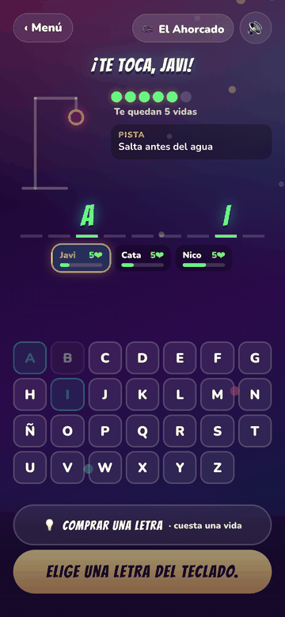<br><sub>Gallows, clue, word and keyboard</sub></td>
  </tr>
  <tr>
    <td align="center">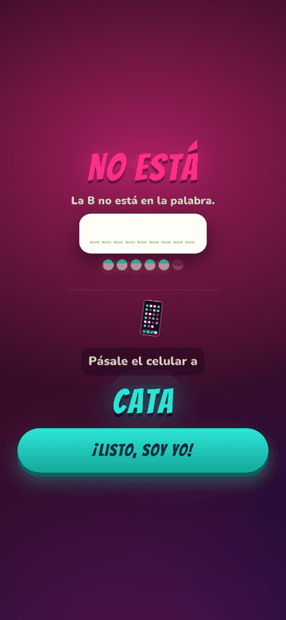<br><sub>The letter and the handoff together</sub></td>
    <td align="center">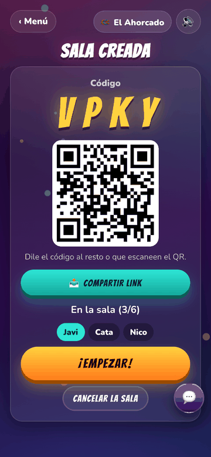<br><sub>Room with code and QR</sub></td>
    <td align="center">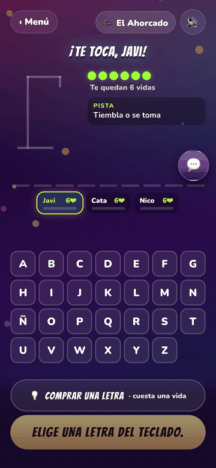<br><sub>Each on their own phone, taking turns</sub></td>
    <td align="center">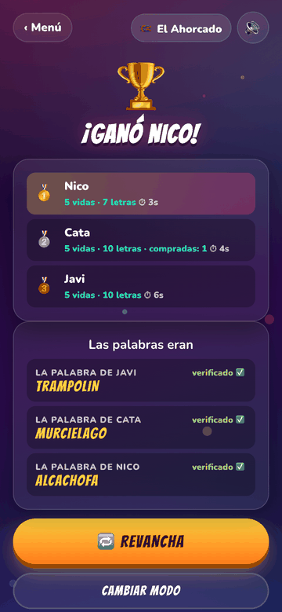<br><sub>Score and verified words</sub></td>
  </tr>
  <tr>
    <td align="center">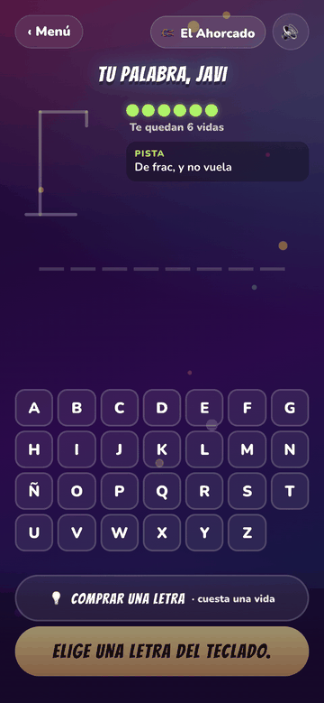<br><sub>Play alone: the phone deals the word</sub></td>
    <td></td>
    <td></td>
    <td></td>
  </tr>
</table>
<!-- /generated -->

The classic, fixed so that **nobody sits and watches**: every player writes the word for the next one and everyone guesses their own, one letter per turn, all boards advancing together. Your score is **the lives you had left**. Five themes and a mix, each with its own words per language (not translations, since a translated word changes length and difficulty); 5, 6 or 8 lives; **buy a letter** 💡 for a life.

| | 🤝 Chain | 🎴 Phone's deck |
|---|---|---|
| Who sets the word | Each player, for the next one, with a mandatory clue | The phone, from the chosen theme |
| What the theme is for | It suggests six words to whoever writes | It is where the word comes from |
| The secret | Committed with a hash and verified at the end | There is none: it comes from the deck seed |

- **📱 One phone** (two to six) · **📡 Several phones** (up to six, one letter at a time; rivals show lives and progress, never letters, D-66) · **🧍 Play alone** (the phone deals the word; the only mode that works without https, D-65).

Spec and design: [docs/games/hangman.md](docs/games/hangman.md)

## 🎲 Liar's Dice (Dudo)

<!-- generated: screenshots:dudo · written by python3 tools/release/readme.py update -->
<table>
  <tr>
    <td align="center"><br><sub>Game modes</sub></td>
    <td align="center"><br><sub>Who plays and whether calzar is on</sub></td>
    <td align="center"><br><sub>Your dice and the table</sub></td>
    <td align="center"><br><sub>Pick face and count</sub></td>
  </tr>
  <tr>
    <td align="center"><br><sub>The table opens up and counts</sub></td>
    <td align="center"><br><sub>Pass the phone</sub></td>
    <td align="center"><br><sub>Room with code and QR</sub></td>
    <td align="center"><br><sub>The table opens up and verifies</sub></td>
  </tr>
  <tr>
    <td align="center"><br><sub>Who won and how it went</sub></td>
    <td></td>
    <td></td>
    <td></td>
  </tr>
</table>
<!-- /generated -->

Everyone rolls five dice and **only looks at their own**. You bet how many dice of one face are on **the whole table** ("four fives"); the next player raises or calls **dudo**, and whoever was wrong loses a die. **Aces are wild**; the last one with dice wins. The phone rolls, **refuses illegal bids** and counts instantly, which is what people argue about. **Calzar** (claiming the exact count) is offered only with three players or more (D-71). In Spanish the faces keep their Chilean names (**ases, tontos, trenes, cuadras, quintas, sextas**), switchable to numbers.

- **📱 One phone** (two to six, a handoff screen between players, C-9) · **🤖 Versus the phone** (it bets on probability and only looks at its own dice) · **📡 Several phones** (each phone rolls its own dice and publishes only a hash, verified on a call, C-10, D-70).

Spec and design: [docs/games/liars-dice.md](docs/games/liars-dice.md)

## 📝 Generala

<!-- generated: screenshots:generala · written by python3 tools/release/readme.py update -->
<table>
  <tr>
    <td align="center"><br><sub>Game modes</sub></td>
    <td align="center"><br><sub>Who plays and whether a rolled generala wins</sub></td>
    <td align="center"><br><sub>Keep dice and pick a box</sub></td>
    <td align="center"><br><sub>What was scored, then pass the phone</sub></td>
  </tr>
  <tr>
    <td align="center"><br><sub>Several phones: watching who rolls</sub></td>
    <td align="center"><br><sub>Generala on the first roll wins</sub></td>
    <td align="center"><br><sub>Final standings</sub></td>
    <td align="center"><br><sub>Solo score and record</sub></td>
  </tr>
</table>
<!-- /generated -->

The Latin American after-dinner dice game: roll five dice **up to three times**, keep the ones you want, and score in one of eleven boxes; highest total wins. A **generala on the first roll wins on the spot** (can be turned off). The phone adds up, shows what every free box is worth now, and blocks illegal moves.

- **📱 One phone** (two to six) · **📡 Several phones** (everyone watches who is rolling, D-246) · **🧍 Play solo** (eleven turns for a record and the `generala_solo` leaderboard).

Opened in v0.189 (D-248, D-405); in **One a Day** from October 23, 2026, with the day's dice (D-247). Its card says it is like Kniffel or Yatzy, and searching either name finds it.

Spec and design: [docs/games/generala.md](docs/games/generala.md)

## ⚓ Battleship (Batalla Naval)

Hide 5 ships on a 10×10 board and fire in turns; a hit lets you fire again. Place ships by tapping or dragging, with rotate and "random". The fleet is **pixel art seen from above**, generated by `python3 tools/generators/fleet.py` into `public/battleship/flota.js` (D-91); sinking a ship is a second-and-a-half animation (D-93), and whose turn it is is shown four ways, never only in words (D-92).

- **📱 One phone** (your fleet covered between turns) · **📡 Two phones** (a room with code, QR and chat; fleets verified at the end, D-138) · **🤖 Versus the phone** (an AI that hunts by parity; about 50 shots to sink a fleet).

<!-- generated: screenshots:batalla-naval · written by python3 tools/release/readme.py update -->
<table>
  <tr>
    <td align="center"><br><sub>Game modes</sub></td>
    <td align="center"><br><sub>Placing the fleet</sub></td>
    <td align="center"><br><sub>Battle</sub></td>
    <td align="center"><br><sub>Result and handoff</sub></td>
  </tr>
  <tr>
    <td align="center"><br><sub>Room with code and QR</sub></td>
    <td align="center"><br><sub>Game on two phones</sub></td>
    <td align="center"><br><sub>Result with both fleets</sub></td>
    <td></td>
  </tr>
</table>
<!-- /generated -->

Spec and design: [docs/games/battleship.md](docs/games/battleship.md)

## 🍹 Julep (Julepe)

> **In the lab's Storeroom since D-434**: off the home page and the search (it had been paused there as "Coming soon" since D-88). It still plays at `/labs/julep/` for lab key holders, rooms included.

<!-- generated: screenshots:julepe · written by python3 tools/release/readme.py update -->
<table>
  <tr>
    <td align="center"><br><sub>Game modes</sub></td>
    <td align="center"><br><sub>How many rivals and how many hands</sub></td>
    <td align="center"><br><sub>In or out, taking turns</sub></td>
    <td align="center"><br><sub>Swap up to three cards</sub></td>
  </tr>
  <tr>
    <td align="center"><br><sub>Illegal cards are dimmed</sub></td>
    <td align="center"><br><sub>A julep: drink the whole pot</sub></td>
    <td align="center"><br><sub>Handing out the sips you won</sub></td>
    <td align="center"><br><sub>Pass the phone</sub></td>
  </tr>
  <tr>
    <td align="center"><br><sub>Room with code and QR</sub></td>
    <td align="center"><br><sub>Who drank the least</sub></td>
    <td></td>
    <td></td>
  </tr>
</table>
<!-- /generated -->

A Tute-family trick-taking game played for sips. Going **in** commits you to win two of five tricks; fall short and you **drink the whole pot**, a **julep**. The phone deals, keeps the pot and **dims illegal cards** with the rule that blocks them. If only one player goes in, the dealer is dragged in (D-83). On several phones each hand is **sealed with its owner's public key** and verified at the end (D-81, C-10); versus the phone, one to five AI rivals. Named Julep in English (*Loo* reads as the toilet) and Paga o Bolo in Portuguese (D-84).

Spec and design: [docs/games/julep.md](docs/games/julep.md)

## 👑 Fourth King (Cuarto Rey)

> **In the lab's Storeroom since D-420**: off the home page, Random game and the search. It still plays at `/labs/fourth-king/` for lab key holders.

The classic drinking card game. The phone is the deck: each player draws a card and the phone says who drinks, runs the minigames, suggests dares and counts the kings. Whoever draws the fourth king drinks what is left, and the last screen shows the sip ranking and every card that came up.

<!-- generated: screenshots:cuarto-rey · written by python3 tools/release/readme.py update -->
<table>
  <tr>
    <td align="center"><br><sub>Intro and rules</sub></td>
    <td align="center"><br><sub>Players and gender</sub></td>
    <td align="center"><br><sub>Tap to draw a card</sub></td>
    <td align="center"><br><sub>Card and instruction</sub></td>
  </tr>
  <tr>
    <td align="center"><br><sub>Minigame with prompts</sub></td>
    <td align="center"><br><sub>Who drinks</sub></td>
    <td align="center"><br><sub>Pass the phone</sub></td>
    <td align="center"><br><sub>Fourth King!</sub></td>
  </tr>
  <tr>
    <td align="center"><br><sub>Sip ranking</sub></td>
    <td align="center"><br><sub>Every card that came up</sub></td>
    <td></td>
    <td></td>
  </tr>
</table>
<!-- /generated -->

Spec: [docs/games/fourth-king.md](docs/games/fourth-king.md)

---

## What every game shares

- **The menu:** filters by kind of game (kept in the link), ⭐ **Favorites** (in the browser, D-238), ✨ **New** and 🔥 **Popular** (D-362, D-364), a 🔎 search (D-387, D-403) and a 🎲 **Random game** die (D-188, D-374). New games sit after The Cup for two weeks (D-333, D-335); the rest are ordered by games finished in the last four weeks (D-361, D-369).
- <a id="one-a-day"></a>**📅 One a Day** (D-230; #1 was 6 October 2026): every day at your midnight, a game and its content come from the date, the same for everyone, picked from every solo-playable game with no repeat within a week (D-334, D-405, D-421). [`/today/`](https://juegosdesalon.cl/today/) keeps your streak (a 🧊 freeze per 7 days, up to 2), a calendar and a **monthly points season**: the day's score plus a streak bonus (D-412, D-414). Signed in: leaderboards, invites that earn a freeze, and optional reminders ([docs/UNO-AL-DIA.md](docs/UNO-AL-DIA.md)). A recap window on the home page shows last month's season (D-424). The first attempt counts from its start: left unfinished, it scores 0, and the way back in skips the die (D-433).
- **Leaderboards** (D-212, D-217): optional sign-in with a name and a 4-digit PIN, no account. Each game keeps your best score and its weekly, all-time, friends and Cup tables; `/records/` adds the All-Rounder and The Cup's medals (D-219); group games keep wins (D-215).
- **Sharing** (D-165, D-171): every message has a `{emoji} *{title}* · {context}` header, one thing per line and the link last; results go out as an **image plus text**, and the text never repeats the image. The menu's share sheet shows the promo video and an **Invite to play** message listing the main features (D-253, D-271, D-410).
- **Languages:** Spanish (default), English, Brazilian Portuguese and German, chosen by hand and saved on the device; the browser language is never guessed (D-47, D-48). See [Languages](#languages).
- **Sound** synthesized with Web Audio, with a 🔊/🔇 button; **saved games** offer to continue; the screen stays awake while playing. A back swipe or «‹ Menú» mid-game asks before leaving (D-432).
- **Installable** as a PWA, with a bubble showing the steps for each phone's browser (D-221, D-232); no offline mode yet.

---

# For developers and the owner

## Stack

Plain HTML, CSS and JavaScript (ES modules). No build step, no npm dependencies. The site is the `public/` folder, published on GitHub Pages by a workflow on every merge to `main` once the tests pass (D-192); the rest of the repo is the workshop. Rooms use **Firebase Realtime Database** (free plan). See [firebase/README.md](firebase/README.md).

## Running it locally

```bash
python3 -m http.server 8765 -d public
```

Then open http://localhost:8765 (ES modules have to be served over HTTP). The tests:

<!-- generated: tests · written by python3 tools/release/readme.py update -->
```bash
node public/battleship/engine.test.mjs
node public/bulls-and-cows/engine.test.mjs
node public/cup/engine.test.mjs
node public/cup/games/agents/engine.test.mjs
node public/cup/games/paint-mines/engine.test.mjs
node public/cup/games/plots/engine.test.mjs
node public/cup/games/routes/engine.test.mjs
node public/generala/engine.test.mjs
node public/hangman/engine.test.mjs
node public/labs/bridges/engine.test.mjs
node public/labs/code/engine.test.mjs
node public/labs/exploding-numbers/engine.test.mjs
node public/labs/fourth-king/engine.test.mjs
node public/labs/julep/engine.test.mjs
node public/labs/pips/engine.test.mjs
node public/liars-dice/engine.test.mjs
node public/timeline/engine.test.mjs
node marketing/served.test.mjs
node marketing/splash/campaigns.test.mjs
node public/assets/js/arrastre.test.mjs
node public/assets/js/azar.test.mjs
node public/assets/js/back-guard.test.mjs
node public/assets/js/buzon.test.mjs
node public/assets/js/compartir.test.mjs
node public/assets/js/daily-attempt.test.mjs
node public/assets/js/daily-points.test.mjs
node public/assets/js/daily-recap.test.mjs
node public/assets/js/favoritos.test.mjs
node public/assets/js/fin.test.mjs
node public/assets/js/games.test.mjs
node public/assets/js/home-windows.test.mjs
node public/assets/js/i18n.test.mjs
node public/assets/js/instalable.test.mjs
node public/assets/js/instalar.test.mjs
node public/assets/js/lab-access.test.mjs
node public/assets/js/labs-puerta.test.mjs
node public/assets/js/llegada.test.mjs
node public/assets/js/parametros.test.mjs
node public/assets/js/push.test.mjs
node public/assets/js/records.test.mjs
node public/assets/js/search.test.mjs
node public/assets/js/splash.test.mjs
node public/assets/js/transport/best-effort.test.mjs
node public/assets/js/transport/cleanup.test.mjs
node public/assets/js/transport/dispose.test.mjs
node public/assets/js/transport/errors.test.mjs
node public/assets/js/transport/ratelimit.test.mjs
node public/assets/js/transport/stats.test.mjs
node public/assets/js/uno-al-dia-avisos.test.mjs
node public/assets/js/uno-al-dia-jugador.test.mjs
node public/assets/js/uno-al-dia.test.mjs
node public/assets/js/vigia.test.mjs
node public/cup/games/deshacer.test.mjs
node public/cup/games/juegos.test.mjs
node public/cup/planilla.test.mjs
node public/cup/recap.test.mjs
node public/cup/reportes.test.mjs
node public/cup/store.test.mjs
node public/home-preload.test.mjs
node public/labs/code/engine-palabra.test.mjs
node public/labs/listed.test.mjs
node public/panel/adapta.test.mjs
node public/panel/aggregate.test.mjs
node public/panel/copas.test.mjs
node public/panel/dominios.test.mjs
node public/panel/rutas.test.mjs
node public/panel/timeline.test.mjs
node tools/agents/approve.test.mjs
node tools/agents/clean-worktrees.test.mjs
node tools/agents/covers.test.mjs
node tools/agents/decision.test.mjs
node tools/agents/document.test.mjs
node tools/agents/english.test.mjs
node tools/agents/feedback-templates.test.mjs
node tools/agents/feedback.test.mjs
node tools/agents/ideas.test.mjs
node tools/agents/inbox.test.mjs
node tools/agents/labs-key.test.mjs
node tools/agents/marketing.test.mjs
node tools/agents/popularity.test.mjs
node tools/agents/processes.test.mjs
node tools/agents/wait-pr.test.mjs
node tools/cloudflare/inbox-worker.test.mjs
node tools/e2e/affected.test.mjs
node tools/e2e/already-tested.test.mjs
node tools/e2e/changes.test.mjs
node tools/e2e/groups.test.mjs
node tools/e2e/output.test.mjs
node tools/e2e/scope-guard.test.mjs
node tools/e2e/scope.test.mjs
node tools/e2e/since-passed.test.mjs
node tools/firebase/rankings-history.test.mjs
node tools/firebase/uad-points-backfill.test.mjs
node tools/firebase/unnoted-rooms.test.mjs
node tools/jobs/jobs.test.mjs
node tools/jobs/machine.test.mjs
node tools/push/daily.test.mjs
node tools/push/notify.test.mjs
node tools/push/schedule.test.mjs
node tools/push/webpush.test.mjs
node tools/release/changelog.test.mjs
node tools/release/merge-report.test.mjs
node tools/release/syntax.test.mjs
node tools/release/version.test.mjs
node tools/reports/weekly-data.test.mjs
```
<!-- /generated -->

### Looking at one screen

```bash
node tools/e2e/look.mjs ahorcado game --width 320
node tools/e2e/look.mjs ahorcado result --lang pt
node tools/e2e/look.mjs panel data --width 900
```

It takes the screenshot and reports horizontal scroll, buttons under 44 px and anything below the bottom edge. Each screen's path lives in `tools/e2e/paths.mjs`; adding one also tests it in every language. To see all of a section's screenshots side by side before publishing (D-76):

```bash
node tools/e2e/contact-sheet.mjs cuarto-rey --out /tmp/contact-sheet
```

To try it on a real phone over HTTPS without publishing (D-67):

```bash
tailscale serve --bg 8765
```

```bash
tailscale serve --https=443 off
```

## Publishing a version

Each pull request leaves its changelog entry, without a number, in `changelog/<branch>.md`; the version is assigned on merge, in the order PRs reach `main` (D-300). Pages in git carry no version: the publish workflow stamps `?v=<version>-<commit>` into the copy it uploads, and comments on the merged PR with the version that went live (D-323). To try the stamp locally:

```bash
python3 tools/release/set-version.py --site /tmp/site
```

## Keeping this README current

```bash
python3 tools/release/readme.py check            # did anything fall behind the code?
python3 tools/release/readme.py update           # rewrites the generated blocks
python3 tools/release/readme.py screenshots <section> [--offline]   # retakes the screenshots
python3 tools/release/readme.py seal             # "I have read it again against these facts"
```

- Everything between `<!-- generated: ... -->` and `<!-- /generated -->` is written by `update` from [`tools/release/facts.mjs`](tools/release/facts.mjs); never edit it by hand.
- Prose is written by a person: `check` compares today's facts with the last seal (`docs/facts.json`) and names what to reread.
- Screenshots come from the `tools/e2e/` scripts named in [`docs/capturas.json`](docs/capturas.json). To add one: take the shot in the script, add the entry, then run `screenshots` and `update`.
- The `tests` check on every PR runs `check` and stays red if the README fell behind (C-11).

## Languages

The whole app is translated, Portuguese as spoken in Brazil and German for Germany, Austria and Switzerland (D-194). The names:

<!-- generated: languages · written by python3 tools/release/readme.py update -->
| Español | English | Português | Deutsch |
|---|---|---|---|
| Juegos de Salón | Party Games | Jogos de Salão | Salonspiele |
| La Copa | The Cup | A Copa | Der Pokal |
| Línea de Tiempo | Timeline | Linha do Tempo | Zeitstrahl |
| Toque y Fama | Bulls and Cows | Toque e Fama | Bullen und Kühe |
| El Ahorcado | Hangman | Forca | Galgenmännchen |
| Dudo | Liar's Dice | Dado Mentiroso | Lügenwürfel |
| Generala | Generala | General | Generala |
| Batalla Naval | Battleship | Batalha Naval | Schiffe versenken |
| Julepe | Julep | Paga o Bolo | Julepe |
| Cuarto Rey | Fourth King | Quarto Rei | Der vierte König |
| Conexiones | Connections | Conexões | Verbindungen |
| Toque y Fama: Palabra | Bulls and Cows: Word | Toque e Fama: Palavra | Bullen und Kühe: Wort |
| ¿En qué año? | What Year? | Em que ano? | Welches Jahr? |
| Reinas | Queens | Rainhas | Damen |
| Tango | Tango | Tango | Tango |
| Zip | Zip | Zip | Zip |
| Desenredo | Untangle | Desenrola | Entwirren |
| ¿Dónde queda? | Where Is It? | Onde fica? | Wo liegt das? |
| El caso | The Case | O Caso | Der Fall |
| Rutas rotas | Broken Routes | Rotas Quebradas | Kaputte Linien |
| Loteo | Plots | Loteamento | Parzellen |
| Pintaminas | Paint Mines | Pinta-Minas | Malminen |
| Agentes | Agents | Agentes | Agenten |
<!-- /generated -->

<!-- generated: screenshots:idiomas · written by python3 tools/release/readme.py update -->
<table>
  <tr>
    <td align="center"><br><sub>Menu in English</sub></td>
    <td align="center"><br><sub>Table in English</sub></td>
    <td></td>
    <td></td>
  </tr>
</table>
<!-- /generated -->

How it is put together (canon C-3):

- `public/assets/js/i18n.js` keeps the language in `localStorage` (`juegos-de-salon:lang`), draws the toggle and holds the shared text (`COMMON`). Each game keeps its text in `LOCALES = { es, en, pt, de }` in its `rules.js`, with no literal string in `game.js`; fixed HTML is marked `data-i18n`.
- **The four dictionaries have the same keys**: `node public/assets/js/i18n.test.mjs` checks keys, list lengths, `{braces}` and empty texts. **Every screen is tested in every language** by `tools/e2e/<folder>/languages.mjs` (D-199).
- Translations are adapted, not copied (Santiago's districts become bairros in Portuguese).
- **The language can travel in the link** (D-74): `?lang=pt` on any page, or the `/en/`, `/pt/` and `/de/` doors; room invitations carry it.
- **A new language starts in the lab** (D-191, `EN_LABS`), offered only through `/labs/<lang>/`; German went through it (D-197; glossary in [docs/ALEMAN.md](docs/ALEMAN.md)).
- The owner dashboard is English only (D-350); the installed app is named in the player's language, one manifest per language (D-222).

## Owner dashboard

`/panel/` is a private page, readable only by the owner's Google account, showing how much the app is played: six sections (**Now**, **La Copa**, **Games**, **Traffic**, **Audience**, **Health**), each against the period before, with a page per cup, game and room and every view in the URL (D-207, D-208, D-233, D-251, D-348). These are usage signals, not tracking: no IP or secret leaves the phone, a random browser id is never joined with names (D-349), and chat is counted, never read (D-138). It keeps no lists of its own: games are read from `public/assets/js/games.js`. See [docs/PANEL.md](docs/PANEL.md).

## Layout

The repo root is not the web root (D-192). `public/` is the site, exactly as served: folder = URL, in English, as are query parameters (`?room=`, `?seed=`, `?test`; `parametros.js` still reads the old Spanish ones, C-18, D-266). Everything next to it is the workshop.

```
public/                     The site (juegosdesalon.cl/): the only folder that gets published
  index.html                  Main menu (generated from assets/js/games.js)
  en/ · pt/ · de/             Language doors
  cup/                        The Cup: engine, stores, score breakdown, CSV export, reports, demos, table image, recap (D-423, D-427)
    games/                    The Cup's games, one folder each (engine.js + ui.js + word content per language)
  timeline/ · bulls-and-cows/ · hangman/ · liars-dice/ · generala/ · battleship/
                              The group games (engine.js + tests, game.js, rules.js, decks/ where needed)
  agents/ · queens/ …         The Cup's games played on their own (generated from cup/suelto/)
  labs/                       The lab, behind a per-person key (D-281, D-284): Active projects and the Storeroom (D-280, D-422)
  records/                    Leaderboards (D-212)
  today/                      One a Day (D-230, D-414)
  panel/                      Private owner dashboard (docs/PANEL.md)
  assets/css/ · assets/js/    Shared styles and modules: games.js (registry), i18n.js, compartir.js (sharing), parametros.js, records.js, uno-al-dia*.js, splash.js, home-windows.js (one window per visit on the home page, D-431), back-guard.js (a back swipe or «‹ Menú» mid-game asks, D-432), search.js, vigia.js (error reporting, D-251) …
  assets/js/transport/        Local, Firebase room and usage-signal transports, with their helpers
  assets/og/                  Social card images
  manifest.webmanifest · sw.js   PWA manifest (one per language) and service worker (D-221, D-222)
  ahorcado/ copa/ …           Bridge pages for the old Spanish URLs (generated, D-192)
docs/                       Requirements, decisions, canons, one spec per game (docs/games/) and the README screenshots
firebase/                   Realtime Database security rules and notes
changelog/                  Each open PR's changelog entry, without a number (D-300)
tools/
  push/                       Phone notifications for The Cup and One a Day (D-223 to D-230)
  release/                    Publishing: version stamp, this README, social cards, icons, changelog, merge reports
  firebase/                   Rules, Cup reports, live-game check, rankings history, room cleanup, One a Day points
  generators/                 Generated content: the map, the Battleship fleet, the lab's bridges
  agents/                     The owner's agents' tools: decisions, worktrees, processes, feedback, inbox, lab keys, splash, ideas
  cloudflare/                 The Email Worker behind hola@juegosdesalon.cl (D-318)
  e2e/                        Full games in headless Chrome, test scope for CI (D-307, D-329, D-308)
  jobs/                       Every scheduled job, listed and checked (D-365)
  reports/                    The weekly report (D-352)
marketing/                  The promo video, splash campaigns and other promotional assets
.claude/                    The project's agents and skills
```

## Contributing

Fork the repo, work on a topic branch and open a pull request to `main`; the tests run on every PR. Your PR brings its changelog entry without a number in `changelog/<your-branch>.md` (D-300), and the owner handles the Firebase rules. The guide is [CONTRIBUTING.md](CONTRIBUTING.md) (D-189).

## License

[MIT](LICENSE).

## Documentation

These documents are being moved to English (D-316); the ones with a Spanish title are still in Spanish.

<!-- generated: docs · written by python3 tools/release/readme.py update -->
- [Cánones y estándares de Juegos de Salón](docs/CANONES.md)
- [Requerimientos](docs/REQUERIMIENTOS.md)
- [Decisions](docs/DECISIONS.md)
- [Cómo agregar un juego nuevo](docs/AGREGAR-JUEGO.md)
- [Panel del dueño](docs/PANEL.md)
- [End-to-end tests (headless Chrome over CDP)](tools/e2e/README.md)
- [Firebase](firebase/README.md)
- [🕵️ Agentes](docs/games/agents.md)
- [Diseño: Batalla Naval](docs/games/battleship.md)
- [🚂 Tren en Vilo (bridge builder, lab)](docs/games/bridges.md)
- [Toque y Fama: estudio de factibilidad y propuesta de mecánica](docs/games/bulls-and-cows-factibilidad.md)
- [Especificación: Toque y Fama](docs/games/bulls-and-cows.md)
- [El caso](docs/games/case.md)
- [🔐 La clave (prototipo del laboratorio, en La Bodega)](docs/games/code.md)
- [La Copa](docs/games/cup.md)
- [💥 Números explosivos (prototipo del laboratorio, en Juegos en prueba)](docs/games/exploding-numbers.md)
- [Especificación: Cuarto Rey](docs/games/fourth-king.md)
- [Diseño: Generala](docs/games/generala.md)
- [Diseño: El Ahorcado](docs/games/hangman.md)
- [Diseño: Julepe](docs/games/julep.md)
- [Diseño: Dudo](docs/games/liars-dice.md)
- [🖌️ Pintaminas (Paint Mines · Pinta-Minas · Malminen)](docs/games/paint-mines.md)
- [🎲 Pips (lab prototype, in Juegos en prueba)](docs/games/pips.md)
- [📐 Loteo (Plots · Loteamento · Parzellen)](docs/games/plots.md)
- [🚇 Rutas rotas (Broken Routes)](docs/games/routes.md)
- [Diseño: Línea de Tiempo](docs/games/timeline.md)
- [Changelog](CHANGELOG.md)
- [El alemán](docs/ALEMAN.md)
- [PR previews (D-429)](docs/PREVIEWS.md)
- [App instalable y avisos al celular (PWA + Web Push)](docs/PWA-NOTIFICACIONES.md)
- [Test scope: which tests a change runs, and how the system learns it (D-391, D-392)](docs/TEST-SCOPE.md)
- [Uno al día](docs/UNO-AL-DIA.md)
- [Guía de usabilidad](docs/USABILIDAD.md)
<!-- /generated -->
